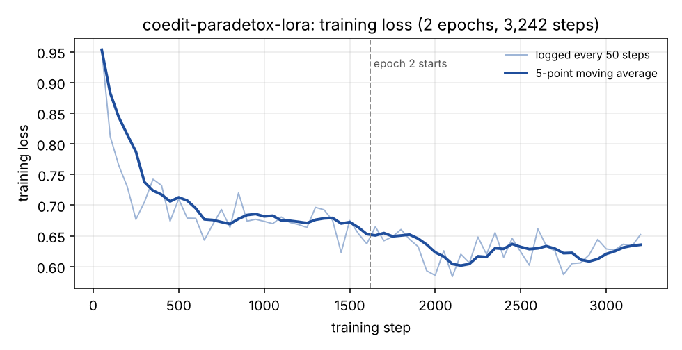

<div align="center">

# SaafBol — CleanSpeak

### A local-first writing assistant for grammar, typos, slang, and offensive-language cleanup

[](https://www.python.org/)
[](https://fastapi.tiangolo.com/)
[](https://developer.chrome.com/docs/extensions/)
[](https://huggingface.co/Shinjan123/coedit-paradetox-lora)

**SaafBol** brings a Grammarly-style clean-up experience to ordinary browser text boxes. It detects and fixes spelling mistakes, grammar issues, slang, and offensive words, then lets the user review and apply the rewritten text. The processing engine runs locally through a FastAPI server; the Chrome extension provides the small draggable robot, live word underlines, and the correction panel.

**CleanSpeak** is the name of the text-cleaning engine, pipeline, and fine-tuned model. **SaafBol** is the name of the Chrome extension (`saaf` = clean, `bol` = speak).

</div>

---

## Table of Contents

- [At a Glance](#-at-a-glance)
- [The Problem and Goals](#-the-problem-and-goals)
- [What the Project Does](#-what-the-project-does)
- [Project Journey](#-project-journey)
- [Final System Architecture](#-final-system-architecture)
- [The CleanSpeak Pipeline](#-the-cleanspeak-pipeline)
- [Models and Fine-Tuning](#-models-and-fine-tuning)
- [Training Loss](#-training-loss)
- [Evaluation and Benchmarks](#-evaluation-and-benchmarks)
- [SaafBol Chrome Extension](#-saafbol-chrome-extension)
- [Run Locally](#-run-locally)
- [CLI and API](#-cli-and-api)
- [Repository Structure](#-repository-structure)
- [Technology Stack](#-technology-stack)
- [Limitations and Known Failures](#-limitations-and-known-failures)
- [Privacy, Ethics, and Licensing](#-privacy-ethics-and-licensing)
- [Future Work](#-future-work)
- [References](#-references)
- [Contact](#-contact)

---

## At a Glance

| Item | Details |
|---|---|
| Project | SaafBol (browser extension) / CleanSpeak (engine and pipeline) |
| Base model | [`grammarly/coedit-large`](https://huggingface.co/grammarly/coedit-large), approximately 770M parameters, FLAN-T5-large based |
| Fine-tuned model | LoRA adapter: [`Shinjan123/coedit-paradetox-lora`](https://huggingface.co/Shinjan123/coedit-paradetox-lora) |
| Typo model | [`oliverguhr/spelling-correction-english-base`](https://huggingface.co/oliverguhr/spelling-correction-english-base), BART-based, approximately 139M parameters |
| Training data | Approximately 25.9k pairs: ParaDetox, 4,000 synthetic slang/typo pairs, and 3,000 CoEdIT replay pairs |
| Fine-tuning | LoRA, 2 epochs, 3,242 steps, 41 minutes 32 seconds on one Google Colab T4 GPU |
| Held-out detox test | Flagged words remaining in 200 test pairs: 101 in the input, 45 after base CoEdIT, and 14 after our adapter |
| Hand-written evaluation | 39 sentences across 6 categories |
| Public benchmark | JFLEG, 1,491 sentences with 4 human corrections per sentence |
| Browser integration | Chrome Manifest V3 extension + local FastAPI server |
| Tested websites | Claude, ChatGPT, and Notion (site-specific behavior still needs verification) |
| Serving setup | Local CPU-based Windows laptop; no paid model API is required |

### Main findings

1. The LoRA adapter reduced the number of outputs containing a flagged word from **45 to 14** compared with base CoEdIT on the same 200 held-out test pairs (about 69% fewer).
2. A single model was not enough. The final system combines deterministic slang rules, a spelling model, the fine-tuned adapter, the original CoEdIT grammar pass, and a final safety net.
3. Automatic metrics did not tell the whole story. Pipeline v2 scored slightly better on the small hand-written set, but v1 was retained because its outputs read more naturally and v2 had been tuned against that same set.
4. The project has important limitations: insults can be deleted rather than rephrased, already-correct sentences can be changed, and the typo model can hallucinate on long or unusual text.

---

## The Problem and Goals

The assigned problem was to design a bot that identifies grammatical mistakes and inappropriate words in a sentence and provides a correction.

We extended that problem to cover:

- Grammar and punctuation correction.
- Common spelling mistakes, repeated letters, and split or merged words.
- Informal slang and filler expressions.
- Profanity and offensive wording.
- Meaning preservation: clean the sentence without unnecessarily changing its intent or tone.
- A usable browser experience inside normal websites and chat boxes, rather than a tool that only underlines mistakes.

### Constraints and design principles

The project was developed under student-project constraints: limited time, a free Colab T4 GPU (approximately 15 GB) for training, and a 16 GB CPU-only Windows laptop for local serving. The design therefore favored small, explainable stages and open models over a paid API or a large model that would be difficult to run locally.

The guiding principles were:

- Keep each stage understandable and independently testable.
- Measure behavior before adding more complexity.
- Prefer careful human inspection of outputs over optimizing a single metric.
- Keep text processing local to the machine running the server.

The current system is English-only.

---

## What the Project Does

SaafBol is designed around a simple interaction:

1. The user focuses a supported text box on a website.
2. A small floating robot appears beside the text box.
3. The user clicks the robot or presses **Alt+Enter** to check the text.
4. The extension sends the text to the local CleanSpeak server.
5. The server runs the cleaning pipeline and returns the cleaned text, flagged words, changes, and stage information.
6. The user reviews the result, then chooses to apply it or copy it.
7. Individual underlined words can also be handled with a one-click action.

The extension is intended to help users revise their own writing. It is not an automatic moderation system and does not silently rewrite text without user action.

---

## Project Journey

The final architecture came from testing several approaches and keeping the parts that solved a specific problem well.

### 1. Choosing the product direction

We considered a web app, a browser extension, an Android app, and an operating-system overlay. A hybrid rules-plus-model engine behind a local FastAPI backend was selected. A web page was useful for early demonstrations, but the Chrome extension became the actual product because it could work inside websites where people already type. Android and OS overlays were skipped because their permissions and implementation effort did not improve the core text-cleaning task.

### 2. Starting with rules

The first design considered LanguageTool for grammar, `better-profanity` for offensive words, and a slang dictionary. Rules are reliable for a closed vocabulary such as common slang, but direct word replacement cannot understand context or preserve tone. For example, replacing `bro` with `friend` everywhere is not necessarily a good rewrite, and a dictionary cannot sensibly rephrase a full insult.

The rule-only design was therefore not used as the main rewriting engine. The slang dictionary remained because it handles a limited, predictable problem deterministically.

### 3. Comparing zero-shot models

Eight test sentences were used to expose common failure modes: slang, insults, double negatives, false-positive traps such as the word `assess`, and sentences that were already correct. The comparison included CoEdIT-large, Qwen2.5-1.5B, Qwen2.5-3B, and `s-nlp/t5-paranmt-detox`.

The main observations were:

- **CoEdIT-large** was the most conservative grammar editor, but it largely ignored slang and was not a dedicated detoxification model.
- **Qwen2.5 models** sometimes over-edited, changed the attitude of a sentence, or introduced meaning changes.
- **The detoxification T5 model** could invert the sentiment or delete part of a sentence.

A few representative observations from the comparison:

| Test input | CoEdIT-large | Qwen2.5-1.5B | Qwen2.5-3B | `s-nlp/t5-paranmt-detox` |
|---|---|---|---|---|
| `you are a bastard and you never listen` | Invented an accusation (`...a liar...`) | Changed `never` to `rarely` | Rewrote it as `You are rude, and you never listen.` | Turned the insult into praise (`You're a badass...`) |
| `that rascal stole my bike yesterday` | Began rewriting as `That guy stole...` | Used `That mischievous person...` | Masked the word but retained the rest | Left `rascal` unchanged |
| `tbh he's a clown, idk why u trust him` | Retained `clown` | Replaced it with `amusing` | Changed the attitude to `funny` | Dropped the clause |
| `The meeting starts at 10 AM tomorrow.` | Dropped `tomorrow` | Changed the time reference to `the day after today` | Left it unchanged | Reformatted the time and dropped `AM` |

CoEdIT-large was selected as the base because it was comparatively conservative. The plan was to teach it the detoxification task with LoRA rather than replace it with a larger general-purpose model.

### 4. Designing the training data

The training set combined three sources:

- **ParaDetox:** human-written toxic-to-neutral sentence pairs for the core detoxification task.
- **Synthetic slang/typo pairs:** 4,000 rule-generated noisy sentences paired with their clean original. Because the target is the original sentence, the intended meaning is preserved by construction.
- **CoEdIT replay:** 3,000 examples from the CoEdIT dataset to help preserve the model's existing editing ability and limit forgetting.

Approximately 500 unique toxic sentences were held out before training. Every row sharing one of those held-out sentences was excluded from the training data to avoid leakage between train and test examples.

The training instruction prefix was:

```text
Clean this sentence:
```

### 5. Fine-tuning CoEdIT with LoRA

LoRA was chosen over full fine-tuning and QLoRA. The 770M-parameter base model fit the available T4 setup in fp32, and LoRA produced a small adapter while leaving the base weights unchanged. Keeping the base unchanged also makes it possible to switch the adapter off for the final grammar pass.

The adapter was trained for two epochs. The run completed in 41 minutes and 32 seconds on one T4 GPU.

### 6. Evaluating the adapter by itself

On the first 200 held-out ParaDetox test pairs, the number of outputs containing a flagged word fell from 101 in the original input to 45 with base CoEdIT and 14 with CoEdIT plus the adapter.

A small forgetting check compared adapter-on and adapter-off outputs on five grammar-only examples. The outputs were identical, but five examples are too few to establish that the model never forgets its original editing skills.

The adapter also exposed two weaknesses: it tended to delete insults rather than rephrase them, and it did not reliably handle slang. The synthetic examples had often taught it to copy the clean target rather than learn a contextual slang transformation.

### 7. Building pipeline v1

The first complete pipeline combined the slang dictionary, the fine-tuned adapter, a backstop for words that remained, the original CoEdIT grammar pass, and a final masking step. It was evaluated on a hand-written set of 39 sentences covering clean text, grammar, slang, insults, profanity, and mixed cases.

It handled clean text, grammar, slang, and expletives reasonably well. Insults and mixed sentences remained difficult: the model could remove the insult but also remove the attitude or the clause carrying the speaker's meaning.

### 8. Testing pipeline v2 — and not adopting it

Pipeline v2 tried replacing known insults with milder words before invoking the model, and added more rules for cleanup. Its aggregate meaning and retention scores on the same 39 sentences were slightly higher than v1.

However, the replacement terms came from our own dictionary (for example, generic phrases such as "unpleasant person", "foolish", and "troublemaker"). When read in context, those insertions often sounded unnatural. The v2 rules were also tuned against the same small hand-written test set, so the improvement was partly by construction. We retained v1 because its model-generated wording read better to us.

### 9. Fixing issues found during real use

Testing revealed several practical problems, which led to targeted changes:

- Mostly-uppercase inputs such as `DANG IT` were normalized because the T5 model did not reliably process shouting-style text.
- An `IGNORE` list was added after mild words were incorrectly masked. It includes `pot`, `gay`, `omg`, `kill`, `dang`, and `wtf`.
- The slang vocabulary was extended with terms such as `bruh`, `bruv`, and `irl`.
- A double instruction prefix was removed.
- A second neutral-rewriting pass was removed because it could delete words (for example, dropping `tomorrow`).
- The profanity list was fixed so custom entries are added to the default list rather than replacing it.

A grammar-first order was tested once and produced different scores, but that run also included slang-dictionary changes, so the effect of the ordering alone could not be isolated. The grammar pass remains at the end of the pipeline.

### 10. Building the SaafBol Chrome extension

The engine was connected to a Chrome Manifest V3 extension. The first version used a floating button and a correction panel, but appeared on too many fields and had a shortcut conflict. The extension was refined to target actual writing areas and to use a draggable robot with inline word underlines, a stage-by-stage result view, and a one-click correction interaction.

### 11. Adding a dedicated typo model

Severe spelling mistakes such as:

```text
the student o f university off enginrering annd mangeenyt
```

were not fixed reliably by the detoxification adapter because it had not been trained as a spelling-correction model. We considered using a larger CoEdIT model, training a byte-level ByT5 model, or adding an existing spelling model. The larger model was impractical for the 16 GB CPU laptop, and training ByT5 would have required substantially more work.

The pretrained BART-based spelling model `oliverguhr/spelling-correction-english-base` was tested and added immediately after the slang dictionary. It is enabled by default, with a switch to disable it. It repaired the severe example and several typo-heavy inputs, although testing also found a regression on a double-negative sentence and later showed hallucination risks on JFLEG.

### 12. Running the public JFLEG benchmark

The final pipeline was evaluated on JFLEG with the typo model both enabled and disabled. The benchmark contains human corrections and is more representative of grammar and fluency editing than the synthetic typo test. Results showed a small overall improvement over the raw input, but also highlighted the pipeline's over-editing problem and the risk introduced by the typo model.

### 13. Documentation and reproducibility

The project includes the fine-tuning notebook, experiments, evaluation notebooks, CSV result files, the local browser extension, and the training-loss image. The repository keeps both the experiments and the final decisions visible so the reasoning behind the current pipeline can be followed.

---

## Final System Architecture

The architecture deliberately separates deterministic text handling, neural rewriting, grammar correction, and browser interaction.

```text
                 User text in a browser field
                             |
                             v
                    SaafBol content.js
                 (find field, bot, underlines)
                             |
                    click bot / Alt+Enter
                             |
                             v
                 Chrome background.js worker
                   (local network requests)
                             |
                             v
              FastAPI server at 127.0.0.1:8000
                             |
                             v
                 CleanSpeak text pipeline
                             |
             +---------------+----------------+
             |                                |
             v                                v
       Slang dictionary                Typo model (BART)
             |                                |
             +---------------+----------------+
                             |
                             v
                CoEdIT-large + LoRA adapter
                             |
                             v
                     Toxic-word backstop
                             |
                             v
              Original CoEdIT grammar pass
                    (adapter switched off)
                             |
                             v
                     Final masking safety net
                             |
                             v
             Clean text + flags + stage details
                             |
                             v
              SaafBol panel -> review -> Apply
```

The backend splits text into sentences and processes them one sentence at a time. The browser extension is the user interface; it does not run a separate React or Vite frontend.

---

## The CleanSpeak Pipeline

The final v1 pipeline contains the following stages, in this order:

| Stage | Component | Purpose | Example / behavior |
|---|---|---|---|
| 0 | `normalize_caps` | Normalizes mostly-uppercase text before model processing. | `DANG IT` → `dang it` |
| 1 | Slang dictionary | Deterministic replacement of known slang and removal of selected filler words. | `gonna` → `going to`; `tbh` → `honestly`; selected uses of `bro` are dropped |
| 1b | BART typo model | Fixes spelling, repeated letters, and split or merged words. | `recieved` → `received`; `o f` → `of` |
| 2 | CoEdIT-large + LoRA adapter | Rewrites or removes offensive wording while trying to retain the sentence's meaning. Prompt: `Clean this sentence:` | A strong expletive may be replaced with a milder word |
| 3 | Backstop | Checks for flagged words that remain and substitutes a milder term from a small list. | `idiot` → `fool` |
| 4 | Original CoEdIT, adapter off | Performs the grammar and punctuation pass using the original base model. Prompt: `Fix the grammar:` | `dont` → `doesn't` |
| 5 | Mask | Final fallback for any flagged word still present: preserve its first letter and mask the rest. | `bullshit` → `b*******` |

### Supporting word lists

- The `better-profanity` vocabulary contains approximately 820 plain words.
- Seven additional mild insults were added.
- The `IGNORE` list avoids flagging words that are not inherently offensive, including `pot`, `gay`, `omg`, `kill`, `dang`, and `wtf`.
- The slang dictionary contains common informal forms and was expanded during real-use testing, including `bruh`, `bruv`, and `irl`.

The word lists are intentionally simple and explainable, but they are also a source of false positives and false negatives. The final backstop and mask help enforce the word-list policy, but they do not guarantee that the meaning or tone has been preserved.

---

## Models and Fine-Tuning

### Base and supporting models

| Model | Role |
|---|---|
| [`grammarly/coedit-large`](https://huggingface.co/grammarly/coedit-large) | Main sequence-to-sequence editor; approximately 770M parameters and based on FLAN-T5-large |
| [`Shinjan123/coedit-paradetox-lora`](https://huggingface.co/Shinjan123/coedit-paradetox-lora) | LoRA adapter trained for the detoxification task |
| [`oliverguhr/spelling-correction-english-base`](https://huggingface.co/oliverguhr/spelling-correction-english-base) | Pretrained BART typo-correction model; approximately 139M parameters |
| `better-profanity` word list | Word-level detection, backstop, and masking support |

### Training data composition

| Source | Approximate pairs | Purpose |
|---|---:|---|
| ParaDetox | 19k | Human-written toxic-to-neutral pairs; teaches the core detoxification task |
| Synthetic slang/typo data | 4,000 | Noisy inputs paired with the clean original sentence |
| CoEdIT replay | 3,000 | Helps preserve the base model's editing behavior |
| **Total** | **~25.9k** | Mixed sequence-to-sequence training set |

The reported source counts are approximate; the project handover records the combined dataset as approximately 25.9k pairs.

### LoRA configuration

| Setting | Value |
|---|---|
| Method | LoRA using PEFT; sequence-to-sequence fine-tuning |
| Rank (`r`) | 16 |
| Alpha | 32 |
| Dropout | 0.05 |
| Target modules | Attention `q` and `v` projections |
| Learning rate | `5e-4` |
| Optimizer / schedule | Trainer default AdamW with linear decay |
| Epochs | 2 |
| Batch size | 16 |
| Training steps | 3,242 |
| Maximum source / target length | 96 tokens |
| Precision | fp32 |
| Seed | 0 |
| Hardware | One Google Colab T4 GPU |
| Training time | 41 minutes 32 seconds |

fp32 was used because T5 was unstable in fp16 in this setup and the available T4 did not provide bf16 for this run. QLoRA was not used because it added complexity without a clear benefit for this 770M-parameter model and hardware budget.

---

## Training Loss

The LoRA training loss decreased quickly during the first part of training, then improved more slowly and reached a noisy plateau during the second epoch.



**Training-loss observations**

| Measure | Value |
|---|---:|
| First logged value (step 50) | 0.953 |
| Mean of first 5 logs | 0.787 |
| Mean over epoch 1 | 0.696 |
| Mean over epoch 2 | 0.627 |
| Minimum | 0.584 at step 2,100 |
| Last logged value (step 3,200) | 0.652 |
| Mean of last 10 logs | 0.624 |

The loss dropped most sharply during roughly the first 650 steps, when the model learned the output format and dominant detoxification pattern. It then declined more gradually. The handover suggested that a third epoch would probably add little, given the plateau.

**Important training caveats:** this is training loss on the mixed dataset, not validation loss. No validation loss was tracked, only the final adapter was saved (no intermediate checkpoints were retained), and this was one training run without a hyperparameter search. Run-to-run variance is therefore unknown.

> Keep `training_loss.png` in the repository root, alongside this README, so the image above renders on GitHub.

---

## Evaluation and Benchmarks

The project used three complementary types of evaluation: a held-out ParaDetox test, a small hand-written set, and the public JFLEG benchmark. These measure different things and should not be treated as interchangeable.

### 1. Held-out ParaDetox: adapter-only comparison

The first 200 held-out test pairs were evaluated with a word-list metric and sentence-embedding similarity. The flagged-word metric counts output sentences containing a word from the `better-profanity` list plus seven added mild insults, while skipping words on the `IGNORE` list. Meaning similarity uses `all-MiniLM-L6-v2` cosine similarity, which is only a rough proxy and cannot reliably detect a flipped tone.

| System | Outputs with flagged words (out of 200) | Meaning vs. input | Meaning vs. reference |
|---|---:|---:|---:|
| Original input | 101 | 1.000 | 0.768 |
| Base CoEdIT-large | 45 | 0.923 | 0.788 |
| CoEdIT-large + our LoRA adapter | **14** | 0.877 | **0.808** |

The adapter reduced flagged outputs from 45 to 14 compared with the base model, while the similarity to the reference increased from 0.788 to 0.808. The adapter also changed the input more, reflected in the lower similarity-to-input score.

Of the 14 flagged outputs, the handover's manual review identified three word-list false alarms (`pot`, `kill`, and `gay`), seven real misses, and one regression. These 14 rows represented 11 unique sentences because ParaDetox contains multiple paraphrases per toxic sentence. A duplicate-free rerun was not performed, so the table should be read as the reported 200-pair comparison.

### 2. Forgetting check

Five grammar-only examples, including incorrect and already-correct sentences, produced identical outputs with the adapter switched off and on. This is a useful initial check, but the sample is too small to prove that the adapter preserves all of CoEdIT's original grammar abilities.

### 3. Hand-written evaluation: 39 sentences

The hand-written set covered six categories. `Meaning` is a sentence-embedding similarity measure; `Retention` is the share of ordinary input words that remain in the output.

| Category | Sentences | Flagged words left | Meaning | Retention | Unchanged |
|---|---:|---:|---:|---:|---:|
| Clean (should not change) | 8 | 0 | 1.00 | 0.98 | 7 of 8 |
| Grammar only | 6 | 0 | 0.95 | 0.80 | n/a |
| Slang | 7 | 0 | 0.81 | 0.97 | n/a |
| Insult | 8 | 0 | 0.77 | 0.84 | n/a |
| Profanity | 6 | 0 | 0.80 | 0.90 | n/a |
| Mixed | 4 | 0 | 0.67 | 0.69 | n/a |

The zero flagged-word count is partly guaranteed by the backstop and masking stages. Meaning and retention are more informative for judging the quality of the final rewrite. The weakest results were on mixed sentences, where both meaning and retention dropped.

#### Why v1 was kept over v2

| Category | v1: meaning / retention | v2: meaning / retention |
|---|---:|---:|
| Clean | 1.00 / 0.98 | 1.00 / 0.98 |
| Grammar | 0.95 / 0.80 | 0.95 / 0.80 |
| Slang | 0.81 / 0.97 | 0.79 / 0.97 |
| Insult | 0.77 / 0.84 | 0.79 / 0.91 |
| Profanity | 0.80 / 0.90 | 0.82 / 0.90 |
| Mixed | 0.67 / 0.69 | 0.75 / 0.75 |
| **All 39** | **0.844 / 0.880** | **0.859 / 0.901** |

V2 had slightly higher aggregate scores, but its rule-inserted replacement phrases often sounded unnatural. V2 was also tuned against the same 39 examples, so the scores are not an independent estimate of generalization. The team chose v1 after reading the outputs.

### 4. Typo-model spot checks

The BART spelling model fixed examples such as:

```text
Input:
the student o f university off enginrering annd mangeenyt

Observed output:
The student of university of engineering and management.
```

It also corrected examples such as `I recieved ur mesage yesterday and it was realy helpfull`. However, the spot checks found a regression where `dont no nothing` became `doesn't do nothing`. The model was therefore useful for severe spelling noise, but it was not risk-free.

### 5. JFLEG public benchmark

The JFLEG evaluation used 1,491 sentences after filtering to 3–60 words. Each sentence has four human corrections. Text was detokenized before evaluation, and outputs were scored with chrF against the reference corrections (0–100). The notebook also checked that batched inference produced the same text as processing one sentence at a time.

| Measure | Typo model ON | Typo model OFF |
|---|---:|---:|
| Average chrF of raw input | 90.3 | 90.3 |
| Average chrF of our output | 91.6 | **91.9** |
| Closer to human corrections | 656 | 668 |
| Further from human corrections | 490 | 430 |
| About the same | 345 | 393 |
| Output equals a human correction | 576 | 614 |
| Already-correct sentences (accepted by annotators) | 485 | 485 |
| Already-correct sentences changed by the pipeline | 247 | 215 |
| Bad words in input / left in output | 10 / 0 | 10 / 0 |

The overall pipeline improved chrF slightly over the raw input. However, the typo model ON setting performed slightly worse than OFF on this benchmark. The spelling model corrected some genuine typos but also rewrote valid words, proper nouns, and parts of longer sentences in ways that were not intended.

**Over-editing is the main JFLEG warning.** Of the 485 inputs that annotators already accepted, the pipeline changed 215 with the typo model OFF (about 44%) and 247 with it ON (about 51%). The evaluation did not isolate whether the adapter or grammar pass caused these changes.

A proposed `spell_merge` guard was tested offline to keep spelling fixes while blocking some unwanted rewrites. The handover records this guard and a six-variant ablation as work in progress, not as part of the final pipeline described here; their results were pending.

### 6. Extension feedback

The local thumbs-up/down log contained four entries: three positive and one negative. One negative example (`dang u bruh`) exposed that `dang` was being masked and `bruh` was not handled as intended. This led to updating the `IGNORE` and slang lists. Four feedback entries are useful debugging signals, not a statistically meaningful user study.

### Representative before/after examples

The handover records the following kinds of outputs. Model wording can vary slightly between runs, so these are observed examples rather than guaranteed exact responses.

| Input | Observed output / expected behavior |
|---|---|
| `bro i is gonna go there, its lit af` | `I am going to go there; it is really exciting.` |
| `I recieved ur mesage yesterday and it was realy helpfull` | `I received your message yesterday, and it was really helpful.` |
| `the student o f university off enginrering annd mangeenyt` | `The student of university of engineering and management.` |
| `DANG IT` | `Dang it!` |
| `The meeting starts at 10 AM tomorrow.` | Should remain unchanged; this is a useful over-editing check. |
| `you are a bastard and you never listen` | One observed output was `You never listen.`; the insult was removed, showing the known tone-retention weakness. |

A useful live demonstration should also show the robot being dragged, the slang/offensive-word underlines, the one-click word action, the stage-by-stage panel, and a thumbs-down feedback example. Run the examples live before presenting because generation can vary.

---

## SaafBol Chrome Extension

The extension is built with Chrome Manifest V3 and communicates with the local FastAPI server.

### Main components

- **`content.js`:** injected into pages and frames; identifies supported text areas, draws the robot, adds underlines, and displays the correction panel.
- **`background.js`:** service worker that makes requests to the local server. This avoids making localhost HTTP requests directly from content scripts running on HTTPS pages.
- **`manifest.json`:** Chrome extension configuration and permissions.
- **`popup.html`:** toolbar popup for extension controls, including per-site behavior.
- **`icons/`:** extension and robot icon assets.
- **Local FastAPI server:** loads the models once and exposes `/check`, `/lexicon`, `/feedback`, and `/health` endpoints.

### Interaction flow

1. The content script detects eligible writing fields and places the draggable robot nearby.
2. The user clicks the robot or presses **Alt+Enter**.
3. The background worker sends the text to the local server.
4. The server runs the sentence-cleaning pipeline.
5. The extension displays the cleaned text, flagged words, changes, and a stage-by-stage explanation.
6. **Apply** writes the cleaned text back using the browser's editing command so React and ProseMirror-based editors can preserve their own state and undo history.
7. The user can copy the result or submit thumbs-up/thumbs-down feedback. Feedback is saved locally.

### Version 0.1 to version 0.2

The first build used a floating `C` button, a result panel with stage details, Apply/Copy/feedback controls, and the shortcut Alt+Shift+C. It worked on a local test page and on Claude, ChatGPT, and Notion after the tabs were refreshed.

Real use exposed several issues: the button appeared in search bars, recipient fields, login pages, and unrelated parts of sites; a `__pycache__` folder inside the extension directory prevented Chrome from loading it; the shortcut conflicted with a Chrome dialog; and the interaction was not as immediate as Grammarly-style inline correction.

Version 0.2, renamed **SaafBol**, addressed those problems:

- Only `textarea` and `contenteditable` fields qualify.
- Single-line inputs, search fields, comboboxes, login fields, short fields, and code editors are excluded.
- Notion, Canva, Figma, and Google Docs are disabled by default and can be controlled through per-site settings.
- The robot can be dragged; its position is remembered per site.
- The robot includes a count badge, blinking eyes, a busy animation, and dark/light theme support.
- The shortcut is now **Alt+Enter** and is handled inside the page.
- Live underlines use **amber for slang** and **red for offensive words**. Clicking an underlined word offers a one-click action such as replacing slang, removing a word, or ignoring it.

Underlines are based on word lists. Grammar correction is performed by the full clean-up operation and is not represented by live grammar underlines.

### Extension testing and compatibility

The project handover records 29 automated checks in a simulated page, covering field filtering, underlines, word cards, dragging, the hotkey, and per-site switches. Underline alignment and write-back still need to be checked on each real website. Although the extension was tested on Claude, ChatGPT, and Notion, website DOM changes can affect compatibility. Google Docs and other canvas-based editors are not supported.

The server processes one request at a time and enforces a 2,000-character input cap. A CPU check takes seconds per sentence, so the project does not attempt whole-sentence checking on every keystroke.

---

## Run Locally

The local setup has two parts: the Python backend and the Chrome extension. There is **no separate frontend development server** to start. The robot and correction UI are loaded directly into Chrome as an unpacked extension.

### Prerequisites

- Python environment containing the dependencies used by the backend.
- Access to the required model weights/checkpoints and their runtime cache.
- Google Chrome with permission to load unpacked extensions.

> **Dependency note:** the supplied repository screenshot does not show a `requirements.txt`, `pyproject.toml`, or pinned environment file. For that reason, this README does not invent a `pip install -r ...` command or claim exact package versions. Use the Python environment in which the project dependencies and model access are already configured. Add a pinned dependency file before expecting a clean install on another machine.

### Step 1 — Start the backend

Open a terminal at the project root and move into the backend directory:

```bash
cd backend
```

Start the FastAPI server with the command used for this project:

```bash
uvicorn server:app --host 127.0.0.1 --port 8000
```

Keep this terminal open while using the extension. The backend loads the models and listens locally at:

```text
http://127.0.0.1:8000
```

The server is bound to `127.0.0.1`, not a public network interface.

### Step 2 — Load the Chrome extension

1. Open Google Chrome.
2. Visit `chrome://extensions`.
3. Turn on **Developer mode**.
4. Click **Load unpacked**.
5. Select the repository's **`extension/`** folder (not the project root and not the backend folder).
6. Confirm that SaafBol appears in the extensions list.
7. Refresh the website/tab where you want to use SaafBol so Chrome injects the content script into that page.

That is the frontend startup step: Chrome loads the unpacked `extension/` directory, and the floating robot appears on supported writing fields. No `npm install`, Vite command, or separate frontend server is part of the shown setup.

### Step 3 — Use SaafBol

1. Keep the backend terminal running.
2. Open a supported website such as a test page, Claude, ChatGPT, or another page with a normal text box.
3. Click inside a supported `textarea` or `contenteditable` editor.
4. Use the floating robot or press **Alt+Enter**.
5. Review the cleaned text and stage details in the panel.
6. Use **Apply** to replace the text, or use **Copy** to copy the result.
7. Use the word underlines for one-click slang/offensive-word actions where available.

### Step 4 — Stop the local server

Return to the terminal running Uvicorn and press **Ctrl+C**. You can disable or remove the unpacked extension from `chrome://extensions` when you no longer need it.

### Local setup troubleshooting

| Problem | Things to check |
|---|---|
| Robot does not appear | Confirm that the backend is running, the correct `extension/` directory was loaded, and the target tab was refreshed after loading the extension. Check that the field is a supported `textarea` or `contenteditable` element. |
| Extension fails to load | Make sure you selected `extension/`, not the project root. Keep generated Python cache folders such as `__pycache__` out of the extension directory. |
| Robot appears in some fields but not others | This is expected: single-line, search, login, combobox, short, and code-editor fields are filtered out. Some sites are disabled by default in per-site settings. |
| Check does not return a result | Make sure the Uvicorn terminal is still running at `127.0.0.1:8000` and that the server finished loading its models. |
| Apply does not work on a website | Write-back depends on the site's editor implementation. The project specifically notes that this must be verified site by site; canvas editors such as Google Docs are unsupported. |
| First request is slow | The backend loads its models once at startup, and CPU inference can take seconds per sentence. |

---

## CLI and API

### Command-line interface

The backend includes a command-line entry point:

```bash
cd backend
python cleanspeak_cli.py
```

The handover documents these options:

```bash
python cleanspeak_cli.py --verbose
python cleanspeak_cli.py --eval
python cleanspeak_cli.py --no-spell
```

- `--verbose` enables more detailed output.
- `--eval` runs the CLI evaluation mode.
- `--no-spell` disables the typo-correction stage.

### Local API endpoints

The FastAPI server documents the following endpoints:

| Endpoint | Purpose |
|---|---|
| `/health` | Health check for the local server |
| `/check` | Runs the text-cleaning pipeline and returns the result/stage information |
| `/lexicon` | Provides word lists used to draw extension underlines |
| `/feedback` | Receives thumbs-up/thumbs-down feedback, which is stored locally |

The handover does not specify the full request/response JSON schema or HTTP method for each route. Check `backend/server.py` for the exact implementation before building another client against these endpoints.

---

## Repository Structure

The following tree reflects the supplied VS Code Explorer screenshot. `__pycache__/` is generated by Python and is not a source-code component.

```text
SaafBol/
│
├── backend/
│   ├── __pycache__/                  # Generated Python bytecode/cache
│   ├── cleanspeak_cli.py             # CleanSpeak engine and command-line interface
│   ├── feedback.json                 # Locally stored extension feedback
│   ├── server.py                     # FastAPI backend and local API routes
│   └── typo_correction.py             # Typo-model helper / test code
│
├── eval/
│   ├── eval_results_v1.csv            # Pipeline v1 evaluation results
│   ├── eval_results_v2.csv            # Pipeline v2 evaluation results
│   ├── jfleg_spell_off.csv            # JFLEG outputs/results with typo model disabled
│   ├── jfleg_spell_on.csv             # JFLEG outputs/results with typo model enabled
│   └── saafbol_jfleg_eval.ipynb        # JFLEG evaluation notebook
│
├── extension/
│   ├── icons/                          # Extension icons
│   ├── background.js                  # Manifest V3 background service worker
│   ├── content.js                     # Page integration, robot, underlines, and panel
│   ├── manifest.json                  # Chrome extension manifest
│   └── popup.html                     # Toolbar popup UI
│
├── evaluation_v1.ipynb                # Pipeline v1 evaluation notebook
├── experiments.ipynb                 # Experiments and pipeline comparisons
├── lora_finetuning.ipynb              # LoRA fine-tuning workflow
├── test_page.html                     # Local browser-extension test page
├── training_loss.png                  # LoRA training-loss plot
└── README.md                          # Project documentation
```

### Where to look

- **Run the application:** `backend/server.py` and `extension/`.
- **Understand the cleaning logic / CLI:** `backend/cleanspeak_cli.py`.
- **Inspect typo correction:** `backend/typo_correction.py`.
- **Review the original fine-tuning run:** `lora_finetuning.ipynb`.
- **Review pipeline experiments:** `experiments.ipynb` and `evaluation_v1.ipynb`.
- **Reproduce or inspect JFLEG evaluation:** `eval/saafbol_jfleg_eval.ipynb` and the paired CSV files.
- **Try the extension on a controlled page:** `test_page.html`.
- **Inspect local feedback:** `backend/feedback.json` (scrub user-entered text before sharing it).

---

## Technology Stack

| Area | Technology / component | Role |
|---|---|---|
| Backend API | Python, FastAPI, Uvicorn | Local inference server and API endpoints |
| Main text model | CoEdIT-large / FLAN-T5-large | Grammar and text editing base model |
| Fine-tuning | LoRA, Hugging Face PEFT | Parameter-efficient detoxification fine-tuning |
| Typo correction | BART spelling-correction model | Repairs spelling noise and split/merged words |
| Word-level checks | `better-profanity` plus custom lists | Slang/profanity lexicon, backstop, masking, and underlines |
| Extension | JavaScript, Chrome Manifest V3 | Page integration, floating robot, panel, and service worker |
| Evaluation | JFLEG, chrF, `all-MiniLM-L6-v2`, CSVs, notebooks | Benchmarking and output analysis |
| Training hardware | Google Colab T4 GPU | LoRA fine-tuning |
| Local serving | CPU-based Windows laptop | Runs the local backend without a paid inference API |

---

## Limitations and Known Failures

The current system is a working prototype, not a perfect grammar checker or a replacement for Grammarly.

### Model and text-quality limitations

- **Insults can be deleted rather than rephrased.** The cleaned sentence may lose the speaker's attitude or part of the original meaning.
- **Meaning can shift.** Some outputs generalize an insult to a phrase such as "bad person" or make a different claim.
- **Over-editing occurs.** On JFLEG, approximately 44% of already-accepted sentences were changed with the typo model off; the figure rose to about 51% with it on.
- **The spelling model can hallucinate.** It may rewrite proper nouns, valid words, digits, or parts of longer sentences. It was slightly worse than disabling the typo model on JFLEG.
- **The lexicon is blunt.** Unlisted insults can pass through, obfuscated spellings such as `sh1t` can be missed, and non-toxic words can be flagged. The `IGNORE` list reduces but does not eliminate false positives.
- **Grammar gaps remain.** Double negatives (for example, `doesn't know nothing`) and pronoun/agreement errors can survive.
- **English only.** Hinglish and multilingual support are future work, not current capabilities.
- **Input length and speed.** The training setup used a maximum sequence length of 96 tokens; the local API has a 2,000-character cap. On CPU, a check can take seconds per sentence.

### Evaluation limitations

- The hand-written evaluation contains only 39 sentences and was partly used during iteration.
- The held-out adapter comparison reports the first 200 test pairs; duplicate paraphrases were not removed for a second run.
- The forgetting check used only five grammar-only examples.
- The JFLEG metric does not fully measure intent, conversational tone, or whether an edit is appropriate.
- Similarity metrics can miss a change in attitude or a subtle meaning shift.
- There was one LoRA training run, no validation-loss curve, no saved intermediate checkpoints, and no hyperparameter search.
- No formal human evaluation study was conducted.

### Browser limitations

- Google Docs and other canvas-based editors are unsupported.
- Write-back behavior depends on the website's editor and needs to be confirmed site by site.
- Live underlines cover word-list matches, not grammar mistakes.
- Site DOM changes may break selectors or editor integration.
- Whole-sentence checks are user-triggered rather than run on every keystroke, partly because CPU inference takes seconds.

---

## Privacy, Ethics, and Licensing

### Privacy and security

- The intended local setup binds the server to `127.0.0.1`; text is sent from the browser page to the local machine and is not sent to a hosted inference API by this setup.
- The local server has **no authentication**. Keep it bound to localhost; do not expose it to a public interface without adding appropriate authentication and security controls.
- The server is documented as skipping password and card fields.
- The local feedback log can contain user text. Remove or anonymize that content before committing, publishing, or sharing `backend/feedback.json`.
- The extension's local-only privacy behavior applies to the local configuration described here. Any future hosted service or optional external model integration would need its own privacy review.

### Responsible use

Detoxification can accidentally erase identity terms, alter reported speech, or put words into someone's mouth. Terms such as `gay` are not inherently toxic and should not be treated as such. Cleaned text should be shown as a suggestion for the writer to review, not used as an automatic moderation or censorship decision.

### Third-party licensing

The project handover records the following license considerations:

- **CoEdIT:** CC BY-NC 4.0 (non-commercial); the adapter inherits the base model's non-commercial restriction.
- **JFLEG:** CC BY-NC-SA 4.0.
- **Typo model:** MIT.
- **ParaDetox:** verify the current dataset card for its exact license and usage conditions before redistribution or commercial use.
- **Qwen2.5:** used only for zero-shot comparison in this project.

These third-party terms do not automatically establish a license for the complete SaafBol repository. Check each dependency, dataset, and model card before redistributing or using the project commercially.

---

## Future Work

The handover prioritizes the following improvements:

1. Run the planned ablation to identify whether the adapter or grammar pass is responsible for most over-editing; test gating the adapter to sentences that are actually flagged.
2. Integrate the `spell_merge` guard only if it continues to pass both JFLEG and synthetic-typo evaluations.
3. Replace or supplement the simple word-list gate with a toxicity classifier so insults not present in the lexicon can be detected.
4. Train the detoxification model to rephrase insults while retaining the speaker's intent and tone; add clean-to-clean examples so already-correct input is more likely to remain unchanged.
5. Consider a byte-level ByT5 spelling model if the pretrained BART model remains too unreliable.
6. Improve CPU latency through a GPU serving option, quantization, or smaller models; then consider delayed checks while typing.
7. Strengthen evaluation with human ratings, larger unseen test sets, validation loss, and intermediate checkpoints.
8. Improve extension compatibility with per-site write-back fixes, inline grammar underlines, and a dedicated settings page.
9. Explore Hinglish and multilingual support.

---

## References

- **CoEdIT paper:** https://arxiv.org/abs/2305.09857
- **CoEdIT-large model:** https://huggingface.co/grammarly/coedit-large
- **LoRA paper:** https://arxiv.org/abs/2106.09685
- **Hugging Face PEFT:** https://github.com/huggingface/peft
- **ParaDetox dataset:** https://huggingface.co/datasets/s-nlp/paradetox
- **ParaDetox paper:** https://arxiv.org/abs/2109.08914
- **CoEdIT dataset:** https://huggingface.co/datasets/grammarly/coedit
- **T5 paper:** https://arxiv.org/abs/1910.10683
- **FLAN paper:** https://arxiv.org/abs/2210.11416
- **Sentence-BERT paper:** https://arxiv.org/abs/1908.10084
- **Experience replay reference:** https://arxiv.org/abs/1811.11682
- **JFLEG paper:** https://arxiv.org/abs/1702.04066
- **JFLEG dataset:** https://huggingface.co/datasets/jhu-clsp/jfleg
- **Typo-correction model:** https://huggingface.co/oliverguhr/spelling-correction-english-base
- **Qwen2.5 paper (comparison only):** https://arxiv.org/abs/2412.15115
- **Transformer paper:** https://arxiv.org/abs/1910.03771

---

## 📬 Contact

Interested in accessibility-focused AI, computer vision, or ML-integrated applications?

- **Email:** [shinjansaha00@gmail.com](mailto:shinjansaha00@gmail.com)
- **LinkedIn:** [Shinjan Saha](https://www.linkedin.com/in/shinjan-saha-1bb744319/)
- **GitHub:** [Code-r4Life](https://github.com/Code-r4Life)

---

<div align="center">

**SaafBol / CleanSpeak**  
*Clean the sentence. Keep the meaning.*

</div>
